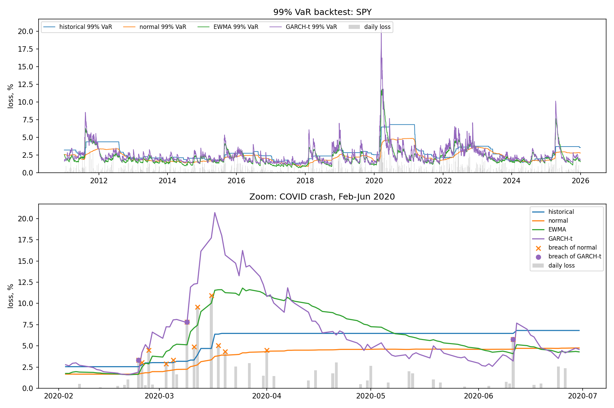

# VaR & Expected Shortfall Backtest: Historical vs. Normal vs. EWMA vs. GARCH-t

**Question:** does assuming normally distributed returns underestimate market risk, especially in stress periods? And does a model that reacts faster to volatility (EWMA), or one that also has fat tails (GARCH-t), fix the problem?

## Data
Daily returns of SPY (S&P 500 ETF), 2010–2025, from Yahoo Finance. SPY is liquid, has a long history and is a standard benchmark for equity market risk. 3,772 forecast days after the first 250-day estimation window.

## Models and choices
Each day, a 99% one-day VaR and Expected Shortfall (ES) are forecast using **only past data** (no look-ahead).

| Model | Idea | Key choice and why |
|---|---|---|
| Historical simulation | Empirical 1% quantile of past returns; no distribution assumed | 250-day window ≈ one trading year |
| Parametric normal | Returns ~ Normal(μ, σ) | Same 250-day window; the textbook benchmark |
| EWMA (RiskMetrics) | Normal, but recent days get more weight | λ = 0.94, the RiskMetrics standard for daily data |
| GARCH(1,1)-t | Volatility dynamics estimated from data + fat-tailed Student-t errors | Re-fitted monthly on up to 1,000 past days (4 parameters need more data than 250 days) |

99% is the Basel market-risk confidence level.

## Backtesting
- **Exception:** a day when the actual loss exceeded the VaR forecast. At 99%, about 1% of days (≈ 37.7) are expected.
- **Kupiec test:** is the number of exceptions consistent with 1%?
- **Christoffersen test:** do exceptions cluster (a breach followed by another breach)?
- **ES check:** on breach days, compare the average actual loss with the average ES forecast.

## Results

| | Historical | Normal | EWMA | GARCH-t |
|---|---|---|---|---|
| Exceptions (expected 37.7) | 58 | 103 | 89 | 57 |
| Exception rate | 1.54% | 2.73% | 2.36% | 1.51% |
| Kupiec p-value | 0.002 | 0.000 | 0.000 | 0.003 |
| Christoffersen p-value | 0.000 | 0.000 | 0.023 | 0.012 |
| Avg loss on breach | 3.45% | 3.03% | 2.73% | 2.81% |
| Avg ES on breach | 2.96% | 2.35% | 2.27% | 2.85% |

Exceptions in stress years: 2020: 8 / 14 / 12 / 6; 2022: 10 / 17 / 3 / 3 (Historical / Normal / EWMA / GARCH-t).



## Interpretation
- **Normal VaR underestimates risk the most:** almost 3× the expected number of breaches, direct evidence of fat tails in equity returns.
- **Historical VaR gets the frequency closer but reacts slowly:** after March 2020 it stays elevated for a full year, and it lagged in 2022 (10 breaches). Its breaches cluster strongly.
- **EWMA fixes speed but not tails:** only 3 breaches in 2022, but 89 overall, because it still assumes normal tails.
- **GARCH-t combines both fixes:** fewest breaches, the best result in 2020, and the only model whose ES matches actual losses on breach days (2.85% vs 2.81%).
- **No model passes Kupiec at 99%:** even GARCH-t slightly underestimates breach frequency.

## Limitations
- Single asset, not a portfolio: no correlation effects.
- Only the 99% level tested.
- GARCH-t spikes to ~20% VaR in March 2020: very reactive, which would mean a sharp jump in capital requirements right after a shock.
- GARCH parameters re-fitted monthly, not daily.
- Symmetric volatility models: they ignore that markets react more to falls than to rises.

## Next steps
- Asymmetric GARCH (GJR-GARCH) to capture the leverage effect.
- Filtered Historical Simulation: GARCH volatility with empirical residuals instead of an assumed distribution.
- 97.5% Expected Shortfall, the measure used under Basel FRTB.

## Run
```bash
pip install -r requirements.txt
python var_backtest.py          # real data
python var_backtest.py --demo   # offline synthetic data
```